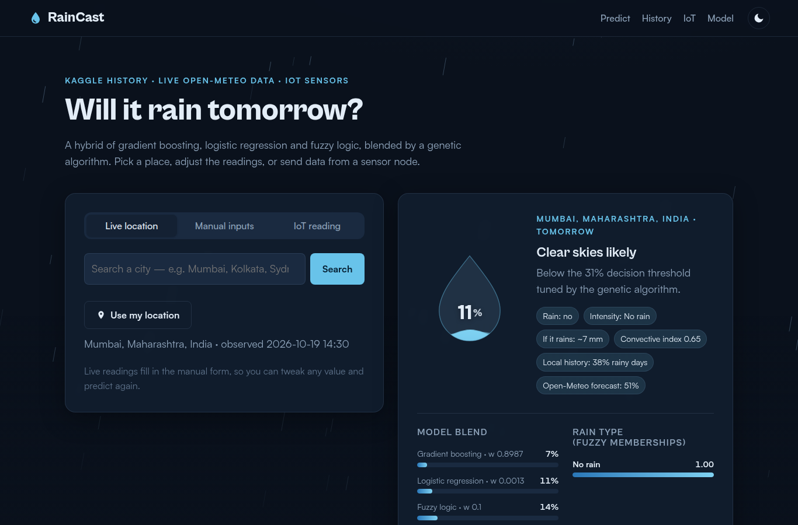
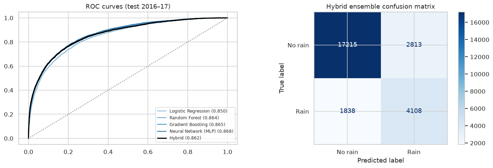
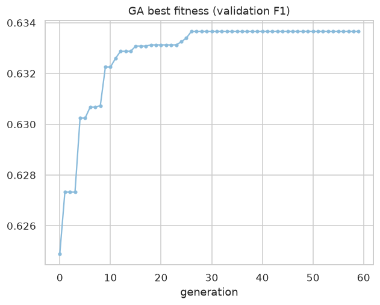
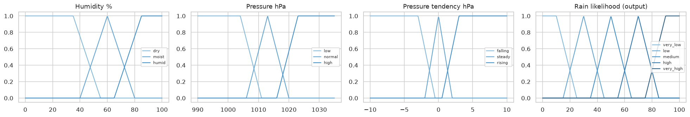
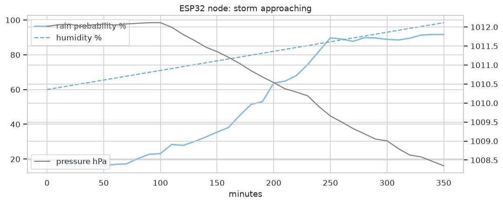

# RainCast: Rain Prediction with ML, Data Science, IoT and Soft Computing

[](https://colab.research.google.com/github/OMDATTA/rain-prediction/blob/main/notebooks/Rain_Prediction.ipynb)
[](https://vercel.com/new/clone?repository-url=https://github.com/OMDATTA/rain-prediction)


RainCast predicts **whether it will rain tomorrow, the probability, and the type of rain** (drizzle, light, moderate, heavy, thunderstorm, and so on). It combines:

* **Historical data**: the Kaggle *Rain in Australia* dataset (about 145k daily observations, 49 stations, 2007–2017)
* **Current weather**: live conditions and the past 7 days from Open-Meteo for any city
* **Local history**: 10-year climatology from the Open-Meteo archive, used as a Bayesian prior
* **User input**: manual readings or live IoT sensor readings

The project is built in **Python** and **Google Colab** and covers **Machine Learning, Data Science, IoT and Soft Computing**. It ships as a rain-themed web app that is ready for **Vercel**.



---

## Features

| Area | Implementation |
|---|---|
| Data science | EDA, missing-value analysis, feature engineering (pressure tendency, humidity delta, wind direction as sin/cos), chronological train/val/test split |
| Machine learning | Logistic Regression, Random Forest, Gradient Boosting, MLP neural network; a Gradient Boosting regressor for rainfall amount |
| Soft computing | Mamdani **fuzzy inference system** (18 rules); **fuzzy rain-type classifier** (IMD categories + convective/thunderstorm index); **genetic algorithm** that evolves the ensemble weights and decision threshold |
| Live + historical data | Open-Meteo forecast API (current + 7 past days), archive API (10-year climatology), geocoding |
| IoT | ESP32 Arduino sketch and a MicroPython version (BME280 + FC-37 rain sensor + RGB LED + buzzer), a Python multi-node simulator, and a `/api/iot` endpoint |
| Web app | Rain theme with animated rainfall whose density follows the predicted probability, a water-drop gauge, storm (dark) and overcast (light) themes, charts, and a model card |
| Deployment | Vercel Python serverless functions with **zero runtime dependencies**: models are exported to JSON and evaluated in pure Python |

## Results (held-out test set, 2016-01-01 to 2017-06-25, 25,974 days)

| Model | Accuracy | Precision | Recall | F1 | ROC-AUC |
|---|---|---|---|---|---|
| Logistic Regression | 0.838 | 0.711 | 0.490 | 0.580 | 0.850 |
| Random Forest | 0.842 | 0.744 | 0.474 | 0.579 | 0.864 |
| Gradient Boosting | 0.843 | 0.723 | 0.513 | 0.600 | 0.865 |
| Neural Network (MLP) | 0.845 | 0.709 | 0.547 | 0.617 | 0.868 |
| Fuzzy Inference (rules only) | 0.777 | 0.511 | 0.576 | 0.542 | 0.784 |
| **Hybrid GA Ensemble** | 0.821 | 0.594 | **0.691** | **0.639** | 0.862 |

The genetic algorithm optimises **F1**, because rain is the minority class (22% of days). It picks a lower threshold (0.31), which catches **69% of rainy days** compared with about 50% for the individual models. The cost is somewhat lower accuracy. The rainfall-amount regressor has a MAE of **6.97 mm** on rainy days.

| ROC and confusion matrix | Genetic algorithm convergence |
|---|---|
|  |  |
| **Fuzzy membership functions** | **IoT stream: storm approaching** |
|  |  |

## How a prediction is made

```
 user input / live city / IoT sensor
            │
            ▼
   feature builder (rainlib/features.py) ── median imputation for missing values
            │
   ┌────────┼──────────────┬───────────────────┐
   ▼        ▼              ▼                   ▼
 Logistic  Gradient     Fuzzy Mamdani     GB regressor
 Regression Boosting    FIS (18 rules)    (rain mm)
   └────────┼──────────────┘                   │
            ▼                                  │
  GA-weighted blend  ◄── 10-yr climatology prior│
            │                                  │
            ▼                                  ▼
   probability + yes/no  ──────►  fuzzy rain-type classifier
                                  (IMD categories + thunderstorm index)
```

## Project structure

```
rain-prediction/
├── api/                    # Vercel serverless functions (Python)
│   ├── predict.py          # POST /api/predict   – user inputs → prediction
│   ├── weather.py          # GET  /api/weather   – live + historical data (+ prediction)
│   ├── iot.py              # POST /api/iot       – ESP32 / sensor endpoint
│   └── health.py           # GET  /api/health    – model metadata & metrics
├── rainlib/                # zero-dependency inference library shared by API, notebook, tests
│   ├── features.py  fuzzy.py  model.py  engine.py  weather.py  http.py
│   └── model.json          # exported models (LR + GBM + regressor + GA ensemble)
├── src/                    # training pipeline
│   ├── train.py            # python -m src.train
│   └── genetic.py          # genetic algorithm
├── notebooks/Rain_Prediction.ipynb   # full Colab notebook (EDA → ML → fuzzy → GA → IoT)
├── iot/
│   ├── esp32_rain_node/esp32_rain_node.ino
│   ├── micropython/main.py
│   └── simulator.py
├── public/                 # rain-themed frontend (HTML/CSS/JS, Chart.js)
├── tests/                  # pytest
├── data/                   # Kaggle CSV goes here (not committed) + 300-row sample
├── vercel.json  pyproject.toml  requirements-train.txt  dev_server.py
```

## Quick start

### 1. Colab (training and experiments)
Click **Open in Colab** above and run all cells. The notebook clones this repo, downloads the Kaggle data with `kagglehub`, runs the EDA, trains and compares the models, runs the fuzzy system and genetic algorithm, predicts for a city you choose, simulates an IoT node, and exports `rainlib/model.json`.

### 2. Local

```bash
git clone https://github.com/OMDATTA/rain-prediction.git && cd rain-prediction
pip install -r requirements-train.txt

# historical data from Kaggle (see data/README.md)
python -c "import kagglehub,shutil,glob; p=kagglehub.dataset_download('jsphyg/weather-dataset-rattle-package'); shutil.copy(glob.glob(p+'/*.csv')[0],'data/weatherAUS.csv')"

python -m src.train          # retrain + export rainlib/model.json (about 2 min)
pytest -q                    # tests
python dev_server.py         # web app + API on http://localhost:8000
```

### 3. Deploy to Vercel
1. Push to GitHub, open [vercel.com/new](https://vercel.com/new) and import the repo.
2. Keep the defaults. `vercel.json` sets `public/` as the static output and `api/*.py` as Python functions.
3. Optional: add the environment variable `IOT_API_KEY` so that devices must send `X-Device-Key`.

Or use the CLI: `npm i -g vercel && vercel --prod`.

## API

```bash
# Predict from your own readings (any subset; missing values are imputed)
curl -X POST https://<app>.vercel.app/api/predict -H 'Content-Type: application/json' -d '{
  "MinTemp": 24, "MaxTemp": 31, "Rainfall": 6, "WindGustSpeed": 48, "WindGustDir": "SW",
  "Humidity9am": 88, "Humidity3pm": 80, "Pressure9am": 1007, "Pressure3pm": 1003.5,
  "Cloud9am": 7, "Cloud3pm": 7, "Temp9am": 26, "Temp3pm": 29, "climatology": 0.4 }'

# Live + historical weather and the prediction for a place
curl "https://<app>.vercel.app/api/weather?lat=22.57&lon=88.36"
curl "https://<app>.vercel.app/api/weather?q=Kolkata"      # geocoding search

# IoT sensor node
curl -X POST https://<app>.vercel.app/api/iot -H 'Content-Type: application/json' \
  -d '{"device_id":"esp32-01","temperature":29.4,"humidity":86,"pressure":1004.2,"pressure_3h_ago":1006.9,"rain_analog":1300}'
# → {"rain_probability": 85, "will_rain": true, "rain_type": "Thunderstorm", "led": "red", "alert": true, ...}
```

Response fields from `/api/predict`: `probability`, `will_rain`, `threshold`, `condition`, `rain_type` (label, intensity, fuzzy memberships, convective index), `expected_mm_if_rain`, `components` (each model's probability and the GA weights), `fuzzy` (memberships and fired rules), `inputs_imputed`.

## IoT hardware

| Part | Pin (ESP32) | Purpose |
|---|---|---|
| BME280 | SDA 21, SCL 22 | temperature, humidity, pressure (and its 3-hour tendency) |
| FC-37 / YL-83 rain plate | AO → GPIO 34 | detects rain falling now (sets RainToday) |
| RGB LED | 25 / 26 / 27 | green < 40%, amber 40–69%, red ≥ 70% |
| Buzzer | 14 | alert for heavy rain or thunderstorm |

Set your Wi-Fi details, API URL and coordinates in `iot/esp32_rain_node/esp32_rain_node.ino` and flash it. If you include `lat`/`lon`, the API fills the readings your sensors don't measure (cloud, wind) with live Open-Meteo data. No hardware? Run `python iot/simulator.py --url http://localhost:8000/api/iot --storm`.

## Notes and limitations
* The ML models learn from Australian stations, so for other climates (for example the Indian monsoon) treat the output as a learning project. The 10-year local climatology prior and the Open-Meteo reference forecast shown in the app help put the number in context.
* The weatherAUS `Rainfall` column measures the 24 hours up to 9 am. The live feature mapping follows the same convention.
* This is not an official forecast. For real decisions, use your national weather service (for example IMD).

## Credits
* Data: [Rain in Australia (Kaggle)](https://www.kaggle.com/datasets/jsphyg/weather-dataset-rattle-package), from the Australian Bureau of Meteorology
* Weather API: [Open-Meteo](https://open-meteo.com/) (CC BY 4.0)
* Rain intensity categories: India Meteorological Department

MIT License
